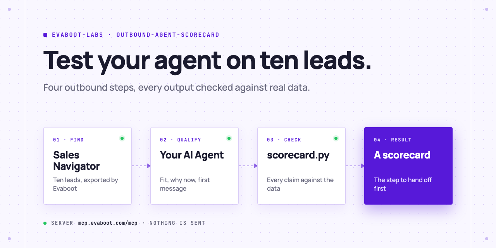
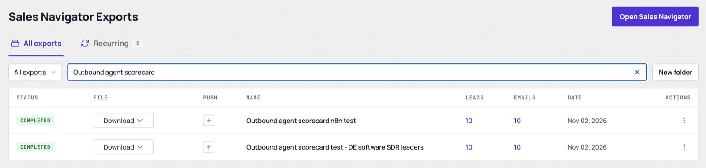
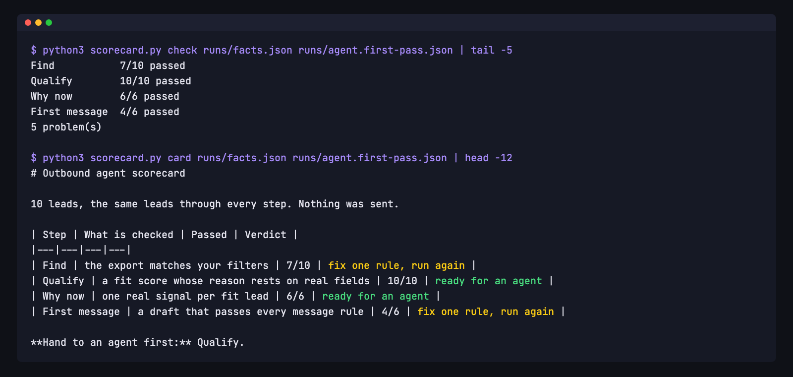
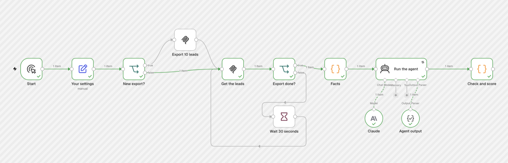

<picture>
  <source media="(prefers-color-scheme: dark)" srcset=".github/assets/banner-dark.png">
  
</picture>

# Outbound agent scorecard

Before you let an AI agent run your outbound, test it on ten real leads. Evaboot exports ten people from your Sales Navigator search. Your AI Agent qualifies each one, finds a reason to reach out now and drafts a first message. A script checks every output against the lead's real data and scores each step, so you know which one to hand to an agent first. Nothing is sent.

[](AGENTS.md)
[](https://evaboot.com/mcp)
[](LICENSE)

## Set it up in one prompt

Paste this into Claude Code, Codex or Cursor:

```text
Clone https://github.com/evaboot-labs/outbound-agent-scorecard, read AGENTS.md and follow the skill. Test an outbound agent on ten Heads of Sales Development in Germany.
```

<details>
<summary>Or install the skill</summary>

Claude Code:

```text
/plugin marketplace add evaboot-labs/outbound-agent-scorecard
/plugin install outbound-agent-scorecard@evaboot-labs-outbound-agent-scorecard
```

Codex, Cursor and other agents:

```bash
npx skills add evaboot-labs/outbound-agent-scorecard
```

</details>

## How it works

**1. Ten real leads.** Your AI Agent turns your ICP into a Sales Navigator search and exports ten people with Evaboot: 10 credits.



**2. Every output checked.** The agent qualifies, finds a why-now and drafts a message for each lead. `scorecard.py` checks each claim against the real fields and scores the four steps. `claimcheck.py` then checks what each draft says about the lead: a number used as the wrong field, a new role that isn't new, growth that went the other way.



**3. The same test in n8n.** One workflow exports the leads, runs Claude and scores the steps. Rerun it on the same ten leads for free after each fix.



## What you need

- An [Evaboot account](https://dash.evaboot.com/accounts/signup/?last_click_origin=outbound-agent-scorecard-repo) and a Sales Navigator seat.
- Claude Code, Codex or Cursor, and Python 3. Or n8n with an Anthropic key.
- Cost: 10 Evaboot credits per test (1 per lead), plus the AI model. Reruns on the same leads cost no credits.

## Go further

| Page | For |
|---|---|
| [ICP.md](ICP.md) | Your buyers, fit rules, offer and message rules |
| [docs/connect-your-agent.md](docs/connect-your-agent.md) | The Evaboot MCP server, by hand, for each agent |
| [docs/n8n.md](docs/n8n.md) | The same test in n8n |

---

Agents: start at [AGENTS.md](AGENTS.md) · Built by [Evaboot](https://evaboot.com) · More workflows at [github.com/evaboot-labs](https://github.com/evaboot-labs) · [MIT license](LICENSE)
